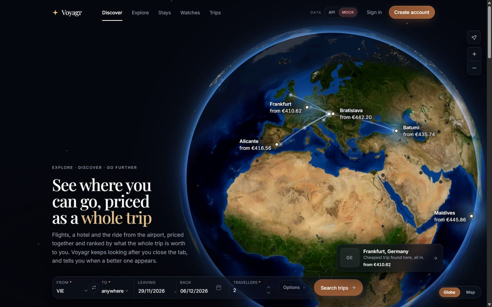

# Voyagr

> **Not yet reflected here:** uncommitted work that was in the tree while this was written (a cookie-consent banner gating the Drive script, a Wikidata places provider with `PLACES_PROVIDER=wikidata` and a `places` cache kind, a `DRIVE_TEST_STUB` test variable). Sections on cookie consent, places and the env table describe commit `0093bcb`; reconcile them when that work is committed.

Voyagr is a travel deal hunter. It searches for complete trips (flights, a stay where one can be
priced, weather, extras) instead of isolated flights, keeps checking prices in the background, and
tells you when a materially better combination appears. Every number a person sees is computed by
deterministic code in `src/core/`; a language model, where one is used, only handles words.

State of the repository: branch `feat/voyagr-autonomous-product-completion`, last commit reviewed
for this file `0093bcb`. It has never been deployed. The decision of record (2026-11-14) is that
production never serves mock data; see [`docs/finish-plan.md`](docs/finish-plan.md).

## What works today, and what needs a key

| Area                             | With no keys (local dev)              | With a key or account                                                |
| -------------------------------- | ------------------------------------- | -------------------------------------------------------------------- |
| Search, trip cost, ranking       | Works on deterministic fixtures       | Real flight prices need `FLIGHT_PROVIDER=aviasales` and a token      |
| Flight prices                    | Fixture prices                        | Aviasales (Travelpayouts) cached price points, not bookable quotes   |
| Stays                            | Fixture stays                         | Affiliate links only (no price); a priced hotel feed does not exist  |
| Weather                          | Open-Meteo (keyless, live)            | Same; the free tier is non-commercial, see `docs/provider-policy.md` |
| Currency conversion              | ECB daily rates (keyless, live)       | Same                                                                 |
| Accounts, watches, alerts        | In memory, lost on restart            | Postgres (`DATABASE_URL`)                                            |
| Background price refresh         | Not running                           | Worker plus Redis (`REDIS_URL`, `QUEUE_DRIVER=bullmq`)               |
| Email                            | Logged to the console                 | Resend (`EMAIL_PROVIDER=resend`, `RESEND_API_KEY`, verified domain)  |
| Push notifications               | Off                                   | VAPID key pair (`npm run vapid:generate`)                            |
| In-app notification bell         | Works for signed-in users             | Same                                                                 |
| Trip hub (plan, expenses)        | Works, in memory                      | Persisted with Postgres (migration 0009)                             |
| AI                               | Deterministic mock only               | `AI_PROVIDER=anthropic` is not implemented and fails at start        |
| Transfers, places, priced hotels | Fixtures in dev; absent in production | No adapter exists                                                    |

In production (`NODE_ENV=production`) mock providers are refused at startup unless
`ALLOW_MOCK_IN_PRODUCTION=true`, which exists only for the end-to-end suite. Slots with no live
adapter (priced hotels, transfers, places) resolve to `absent`, and the cost line is `excluded`,
not zero.

Not verified: real email delivery, live Aviasales calendar calls from a deployed host, and
migrations 0008 and 0009 against a real Postgres. See `STATUS.md`, "Not verified yet".

## Screenshots

Captured on 2026-11-15 from a development build running on fixture data (the `API / MOCK` switch
in the header only appears outside production). Prices in them are fixtures, not real fares. The
destination shot shows "Updated 303 d ago" because fixture timestamps are old; that is a fixture
artefact. The home and sign-in shots were taken on the day of the shared-globe commit; the explore
and destination shots slightly earlier, before the final end-to-end fixes.

| Page                               | File                                                                   |
| ---------------------------------- | ---------------------------------------------------------------------- |
| Home: globe, search bar            | [`docs/screenshots/home.jpg`](docs/screenshots/home.jpg)               |
| Explore: results (top of the page) | [`docs/screenshots/explore.jpg`](docs/screenshots/explore.jpg)         |
| Destination: Antalya               | [`docs/screenshots/destination.jpg`](docs/screenshots/destination.jpg) |
| Sign in                            | [`docs/screenshots/sign-in.jpg`](docs/screenshots/sign-in.jpg)         |



## Quick start

Needs Node 24.15 or newer (`engines.node`, `.node-version`, and `engine-strict=true` in `.npmrc`
make an older Node a hard failure).

```bash
npm ci
cp .env.example .env     # optional; every value has a working default
npm run dev              # http://localhost:3000
```

`next dev` reads `.env.local` and `.env`. `npm run worker` and `npm run db:migrate` read `.env`
only, so use that name if you want all three to see the same values.

The worker is a separate process. Locally it is optional; without Redis its cache refreshes go to
its own memory and no page sees them (it logs a warning saying so).

```bash
npm run worker           # background jobs: watches, notifications, cache refresh
npm run db:migrate       # only when DATABASE_URL points at a real database
```

For a real deployment follow [`SETUP-CHECKLIST.md`](SETUP-CHECKLIST.md) and
[`docs/runbook.md`](docs/runbook.md).

## Environment variables

Declared in `src/lib/env.ts`, which is the only file that reads `process.env`. An invalid value
fails at startup and names the variable, never its value. Unset optional values turn a capability
off; they do not crash the app. The "Production" column says what a real deployment needs.

| Variable                                                                                 | Purpose                                                         | Default                          | Production                                          |
| ---------------------------------------------------------------------------------------- | --------------------------------------------------------------- | -------------------------------- | --------------------------------------------------- |
| `NODE_ENV`                                                                               | `development`, `test`, `production`                             | `development`                    | `production` (set by `next start`)                  |
| `NEXT_PUBLIC_APP_URL`                                                                    | Origin used in links inside emails                              | `http://localhost:3000`          | Required: set to the real origin                    |
| `PUBLIC_BASE_URL`                                                                        | Origin for sitemap and robots; empty sitemap if unset           | unset                            | Recommended                                         |
| `LOG_LEVEL`                                                                              | `fatal` to `trace`                                              | `info`                           | Optional                                            |
| `DATABASE_URL`                                                                           | Postgres connection string                                      | unset (in-memory)                | Required                                            |
| `DATABASE_SSL`                                                                           | TLS to Postgres                                                 | `false`                          | Usually `true` on a managed host                    |
| `DATABASE_POOL_MAX`                                                                      | Pool size, 1 to 100                                             | `10`                             | Optional                                            |
| `REDIS_URL`                                                                              | Shared cache and BullMQ queue                                   | unset                            | Required (worker and web must share it)             |
| `QUEUE_DRIVER`                                                                           | `memory` or `bullmq`; `bullmq` needs `REDIS_URL`                | `memory`                         | `bullmq`                                            |
| `PRICE_REFRESH_MINUTES`                                                                  | Worker cache refresh interval, 1 to 1440                        | `30`                             | Optional; see quota maths in `docs/architecture.md` |
| `HOTEL_REFRESH_MINUTES`                                                                  | Reserved for stays; read by no code today                       | `360`                            | Not needed                                          |
| `FLEX_DAYS`                                                                              | Days either side shown by the flexible-dates strip, 0 to 7      | `3`                              | Optional                                            |
| `AI_PROVIDER`                                                                            | `mock` or `anthropic` (anthropic is not implemented)            | `mock`                           | Leave `mock`                                        |
| `AI_MODEL`                                                                               | Model name for a future adapter                                 | `claude-sonnet-5`                | Not used                                            |
| `ANTHROPIC_API_KEY`                                                                      | Key for a future adapter                                        | unset                            | Not used                                            |
| `FLIGHT_PROVIDER`                                                                        | `mock`, `live`, `aviasales` (`live` has no adapter)             | `mock`                           | `aviasales`; `mock` is refused                      |
| `AVIASALES_API_TOKEN`                                                                    | Travelpayouts Data API token (secret)                           | unset                            | Required with `aviasales`                           |
| `AVIASALES_PARTNER_ID`                                                                   | Affiliate marker in outbound links (public)                     | unset                            | Required for affiliate links                        |
| `TRAVELPAYOUTS_HOTEL_PROGRAM_ID`                                                         | Hotel programme for "Find a stay" links (public)                | unset                            | Needed for `travelpayouts-links`                    |
| `TRAVELPAYOUTS_HOTEL_CAMPAIGN_ID`                                                        | Hotel campaign for those links (public)                         | unset                            | Needed for `travelpayouts-links`                    |
| `STAY_PROVIDERS`                                                                         | Comma list: `mock`, `absent`, `travelpayouts-links`             | `mock` (`absent` in production)  | `travelpayouts-links` for link-out stays            |
| `HOTEL_PROVIDER`                                                                         | Priced hotels for trip totals: `mock`, `live`, `absent`         | `mock` (`absent` in production)  | `absent` (no priced adapter exists)                 |
| `WEATHER_PROVIDER`                                                                       | `mock`, `live`, `open-meteo`                                    | `open-meteo` (`mock` under test) | `open-meteo`                                        |
| `TRANSFER_PROVIDER`                                                                      | `mock`, `live`, `absent`                                        | `mock` (`absent` in production)  | `absent`                                            |
| `PLACES_PROVIDER`                                                                        | `mock`, `live`, `absent`                                        | `mock` (`absent` in production)  | `absent`                                            |
| `FX_PROVIDER`                                                                            | `mock` (no rates) or `ecb`                                      | `ecb`                            | `ecb`                                               |
| `FLIGHT_PROVIDER_API_KEY` and the four `HOTEL`/`WEATHER`/`TRANSFER`/`PLACES` equivalents | Declared and redacted in logs; no code reads them               | unset                            | Not used                                            |
| `IMAGERY_PROVIDER`                                                                       | `wikimedia` or `none` (photo fallback when no illustration)     | `wikimedia`                      | Optional                                            |
| `EMAIL_PROVIDER`                                                                         | `console` or `resend`                                           | `console`                        | `resend`; `console` is refused                      |
| `RESEND_API_KEY`                                                                         | Resend API key (secret)                                         | unset                            | Required with `resend`                              |
| `EMAIL_FROM`                                                                             | Sender                                                          | `Voyagr <hello@voyagrfind.com>`  | Must be on a verified Resend domain                 |
| `EMAIL_REPLY_TO`                                                                         | Reply-to address                                                | unset                            | Optional                                            |
| `EMAIL_POSTAL_ADDRESS`                                                                   | Postal address in email footers; a visible placeholder if unset | unset                            | Optional                                            |
| `NEXT_PUBLIC_VAPID_PUBLIC_KEY`                                                           | Web Push public key                                             | unset (push off)                 | Needed for push                                     |
| `VAPID_PRIVATE_KEY`                                                                      | Web Push private key (secret)                                   | unset (push off)                 | Needed for push                                     |
| `VAPID_SUBJECT`                                                                          | `mailto:` contact for push services                             | `mailto:dev@example.invalid`     | Set your own                                        |
| `DATA_SOURCE_SWITCH`                                                                     | Show the runtime API/MOCK switch                                | unset (on outside production)    | Leave unset                                         |
| `ALLOW_MOCK_IN_PRODUCTION`                                                               | Lets a production build serve fixtures                          | `false`                          | Never set in a real deployment                      |

Secrets (never logged): `DATABASE_URL`, `REDIS_URL`, `ANTHROPIC_API_KEY`, the five
`*_PROVIDER_API_KEY`, `AVIASALES_API_TOKEN`, `VAPID_PRIVATE_KEY`, `RESEND_API_KEY`.

## Scripts

| Script                   | Does                                                                           |
| ------------------------ | ------------------------------------------------------------------------------ |
| `npm run dev`            | Development server (copies the MapLibre worker first)                          |
| `npm run build`          | Production build (copies the MapLibre worker first)                            |
| `npm start`              | Serve the production build                                                     |
| `npm run worker`         | Background worker as its own process; reads `.env`                             |
| `npm run db:migrate`     | Apply SQL migrations; reads `.env`                                             |
| `npm test`               | Unit and component tests (Vitest)                                              |
| `npm run test:watch`     | The same, in watch mode                                                        |
| `npm run test:coverage`  | Tests with coverage                                                            |
| `npm run test:db`        | Postgres repository contract suite (needs `TEST_DATABASE_URL`)                 |
| `npm run test:e2e`       | Playwright against a production build                                          |
| `npm run test:e2e:ui`    | Playwright UI mode                                                             |
| `npm run e2e:install`    | Install Playwright's Chromium                                                  |
| `npm run lint`           | ESLint                                                                         |
| `npm run lint:fix`       | ESLint with fixes                                                              |
| `npm run format`         | Prettier, write                                                                |
| `npm run format:check`   | Prettier, check                                                                |
| `npm run typecheck`      | `tsc --noEmit`                                                                 |
| `npm run verify`         | format check, lint, typecheck, test, build                                     |
| `npm run check:calendar` | Probe the Aviasales calendar for a route (`scripts/check-calendar-prices.mjs`) |
| `npm run vapid:generate` | Print a Web Push key pair                                                      |
| `npm run icons:generate` | Regenerate PWA icons                                                           |

Data-build scripts, run by hand and committed with their output: `scripts/build-geo.mjs`,
`build-airports.mjs`, `build-earth-texture.mjs`, `build-city-lights.mjs`, `build-emergency.mjs`,
`export-destination-images.mjs`. Several import `sharp`, which is not in `package.json`; it is
present in `node_modules` through Next.js.

## Testing

```bash
npm test                                    # unit and component
npm run test:e2e                            # Playwright, production build, desktop and phone
PLAYWRIGHT_CHANNEL=chrome npm run test:e2e  # use a locally installed Chrome
npm run test:e2e -- --workers=4             # fewer workers if the globe makes the suite flake
npm run verify                              # run before calling anything done
```

Numbers and details: [`docs/testing.md`](docs/testing.md).

## Project layout

```
src/
  core/            Pure domain logic: money, trip cost/constraints/scoring, dates, fx, freshness,
                   flex-dates, expenses (shared-expense arithmetic)
  search/          Search planning, orchestration, assembly, day prices (price calendar)
  discovery/       The globe's data: countries, routes, snapshot, stage loader
  providers/       Adapters behind interfaces, registry, mock policy, absent slots
  cache/           Cache store (memory, Redis), read-through, refresh targets and job
  worker/          The worker process entry and maintenance sweeps
  queue/           Job contract, in-process and BullMQ drivers
  watches/         Travel Watch refresh and scheduler
  notifications/   Web Push channel, in-app feed, alert preferences
  email/           Provider interface, console and Resend drivers, templates
  booking/         Partner registry and link hand-off checks
  trip-hub/        Trips, plan items, expenses service, emergency data
  auth/            Accounts, sessions, throttles, token flows
  ai/              AI interface, guardrails, mock provider
  db/              Repository interfaces, memory and Postgres implementations, migrations
  lib/             env, logger, errors, Result
  components/      ui/ (design system), discovery/ (globe), home/, search/, destination/, partners/
  app/             Next.js App Router: (stage), (column), (auth) route groups, api/
  proxy.ts         Per-request CSP nonce
scripts/           Data builds, worker launcher, migration runner
tests/e2e/         Playwright specs and support helpers
```

## Documentation

| Document                                                         | Contents                                              |
| ---------------------------------------------------------------- | ----------------------------------------------------- |
| [`docs/PRODUCT-SPECIFICATION.md`](docs/PRODUCT-SPECIFICATION.md) | The product. Source of truth.                         |
| [`docs/architecture.md`](docs/architecture.md)                   | How it is built, caching, data flow, go-live decision |
| [`docs/runbook.md`](docs/runbook.md)                             | Running web and worker, cache, quota, email, deploy   |
| [`SETUP-CHECKLIST.md`](SETUP-CHECKLIST.md)                       | Going-live checklist                                  |
| [`WHAT-I-NEED-FROM-YOU.md`](WHAT-I-NEED-FROM-YOU.md)             | Accounts, keys and DNS the owner must supply          |
| [`docs/finish-plan.md`](docs/finish-plan.md)                     | Decision log D1 to D20                                |
| [`docs/design-direction.md`](docs/design-direction.md)           | Design direction, with what was and was not built     |
| [`DESIGN.md`](DESIGN.md)                                         | Tokens as they exist in `globals.css`                 |
| [`docs/design-system.md`](docs/design-system.md)                 | Components and accessibility rules                    |
| [`docs/testing.md`](docs/testing.md)                             | Testing strategy and current numbers                  |
| [`docs/security.md`](docs/security.md)                           | Security baseline and known gaps                      |
| [`docs/provider-policy.md`](docs/provider-policy.md)             | Status of every data provider                         |
| [`docs/deployment-checklist.md`](docs/deployment-checklist.md)   | Earlier deployment notes                              |
| [`progress.md`](progress.md), [`STATUS.md`](STATUS.md)           | History and current state                             |

## Licence

Not yet chosen.
